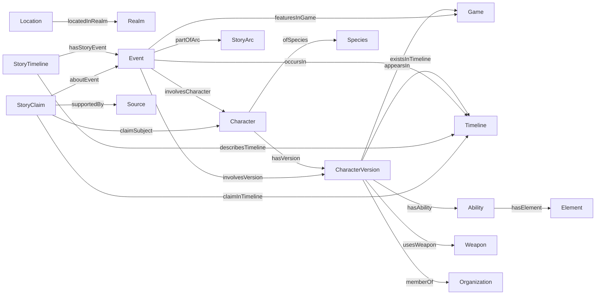

# Ontologi Mortal Kombat Knowledge Nexus (v2.0)

> Dokumen ini dihasilkan otomatis oleh `scripts/kb_tools.py docs` dari `ontology/core.ttl`. Jangan diedit manual.

## 1. Hierarki Class

```text
mk:Entity  (Entity)
  mk:Ability  (Ability)
    mk:Move  (Move)
      mk:Brutality  (Brutality)
      mk:Fatality  (Fatality)
      mk:SpecialMove  (Special Move)
  mk:Character  (Character)
  mk:CharacterVersion  (Character Version)
  mk:Element  (Element)
  mk:Event  (Story Event)
  mk:Game  (Game)
  mk:Location  (Location)
    mk:Arena  (Arena)
    mk:Realm  (Realm)
  mk:Organization  (Organization)
    mk:Clan  (Clan)
    mk:Faction  (Faction)
  mk:Source  (Source)
  mk:Species  (Species)
  mk:StoryArc  (Story Arc)
  mk:StoryClaim  (Story Claim)
  mk:StoryTimeline  (Story Timeline)
  mk:Timeline  (Timeline)
  mk:Weapon  (Weapon)
```

Total: **24 class**, **48 object property**, **28 datatype property**.

## 2. Object Properties

| Property | Domain | Range | Karakteristik / Catatan |
|---|---|---|---|
| `mk:aboutEvent` | `mk:StoryClaim` | `mk:Event` | inverse: `mk:hasClaim` |
| `mk:alliedWith` | `mk:Character` ∪ `mk:CharacterVersion` | `mk:Character` ∪ `mk:CharacterVersion` | Symmetric; sub-property of `mk:relatedTo` |
| `mk:allyOf` | `mk:Character` ∪ `mk:CharacterVersion` | `mk:Character` ∪ `mk:CharacterVersion` | Symmetric; sub-property of `mk:alliedWith` |
| `mk:appearsIn` | `mk:CharacterVersion` | `mk:Game` | inverse: `mk:featuresVersion` |
| `mk:causedBy` | `mk:Event` | `mk:Entity` |  |
| `mk:claimInTimeline` | `mk:StoryClaim` | `mk:Timeline` |  - Timeline(s) in which the claim is valid |
| `mk:claimObject` | `mk:StoryClaim` | `mk:Character` |  |
| `mk:claimSubject` | `mk:StoryClaim` | `mk:Character` |  |
| `mk:describesTimeline` | `mk:StoryTimeline` | `mk:Timeline` | Functional; inverse: `mk:hasStoryTimeline` |
| `mk:enemyOf` | `mk:Character` ∪ `mk:CharacterVersion` | `mk:Character` ∪ `mk:CharacterVersion` | Symmetric; Irreflexive; sub-property of `mk:relatedTo` |
| `mk:existsInTimeline` | `mk:CharacterVersion` | `mk:Timeline` | Functional; inverse: `mk:hasTimelineVersion` - A CharacterVersion belongs to exactly one Timeline; this is what separates one incarnation from another across continuities |
| `mk:featuresInGame` | `mk:Event` | `mk:Game` |  |
| `mk:featuresVersion` | `mk:Game` | `mk:CharacterVersion` |  |
| `mk:firstEvent` | `mk:StoryTimeline` | `mk:Event` | Functional; sub-property of `mk:hasStoryEvent` |
| `mk:follows` | `mk:Event` | `mk:Event` | Transitive |
| `mk:hasAbility` | `mk:CharacterVersion` | `mk:Ability` |  |
| `mk:hasClaim` | `mk:Event` | `mk:StoryClaim` |  |
| `mk:hasElement` | `mk:Ability` | `mk:Element` |  |
| `mk:hasMember` | `mk:Organization` | `mk:CharacterVersion` |  |
| `mk:hasSource` | `mk:Entity` | `mk:Source` |  |
| `mk:hasStoryEvent` | `mk:StoryTimeline` | `mk:Event` | inverse: `mk:inStoryTimeline` |
| `mk:hasStoryTimeline` | `mk:Timeline` | `mk:StoryTimeline` |  |
| `mk:hasTimelineVersion` | `mk:Timeline` | `mk:CharacterVersion` |  |
| `mk:hasVersion` | `mk:Character` | `mk:CharacterVersion` | inverse: `mk:versionOf` |
| `mk:inStoryTimeline` | `mk:Event` | `mk:StoryTimeline` |  |
| `mk:involvesCharacter` | `mk:Event` | `mk:Character` |  |
| `mk:involvesVersion` | `mk:Event` | `mk:CharacterVersion` |  - The CharacterVersion (of the event's timeline) that took part in the event |
| `mk:lastEvent` | `mk:StoryTimeline` | `mk:Event` | Functional; sub-property of `mk:hasStoryEvent` |
| `mk:locatedIn` | `mk:Location` | `mk:Location` | Transitive |
| `mk:locatedInRealm` | `mk:Location` | `mk:Realm` | sub-property of `mk:locatedIn` |
| `mk:memberOf` | `mk:CharacterVersion` | `mk:Organization` | inverse: `mk:hasMember` |
| `mk:nextTimeline` | `mk:Timeline` | `mk:Timeline` | Functional - The continuity that chronologically follows this one |
| `mk:nextVersion` | `mk:CharacterVersion` | `mk:CharacterVersion` | Functional; InverseFunctional; inverse: `mk:previousVersion` - Next incarnation of the same character ordered by game release date |
| `mk:occursIn` | `mk:Event` | `mk:Timeline` | Functional |
| `mk:occursInTimeline` | `mk:Event` | `mk:Timeline` | sub-property of `mk:occursIn` |
| `mk:ofSpecies` | `mk:Character` | `mk:Species` |  |
| `mk:originatesFrom` | `mk:Character` ∪ `mk:CharacterVersion` | `mk:Location` |  |
| `mk:partOfArc` | `mk:Event` | `mk:StoryArc` |  |
| `mk:performsMove` | `mk:CharacterVersion` | `mk:Move` | sub-property of `mk:hasAbility` |
| `mk:precedes` | `mk:Event` | `mk:Event` | Transitive; inverse: `mk:follows` |
| `mk:previousVersion` | `mk:CharacterVersion` | `mk:CharacterVersion` | Functional; InverseFunctional |
| `mk:relatedTo` | `mk:Character` ∪ `mk:CharacterVersion` | `mk:Character` ∪ `mk:CharacterVersion` | Symmetric |
| `mk:rivalOf` | `mk:Character` ∪ `mk:CharacterVersion` | `mk:Character` ∪ `mk:CharacterVersion` | Symmetric; Irreflexive; sub-property of `mk:enemyOf` |
| `mk:supportedBy` | `mk:StoryClaim` | `mk:Source` | sub-property of `mk:hasSource` |
| `mk:takesPlaceAt` | `mk:Event` | `mk:Location` |  |
| `mk:usedBy` | `mk:Weapon` | `mk:CharacterVersion` |  |
| `mk:usesWeapon` | `mk:CharacterVersion` | `mk:Weapon` | inverse: `mk:usedBy` |
| `mk:versionOf` | `mk:CharacterVersion` | `mk:Character` | Functional - Every CharacterVersion belongs to exactly one Character |

## 3. Datatype Properties

| Property | Domain | Range | Catatan |
|---|---|---|---|
| `mk:alternateName` | `mk:Entity` | `xsd:string` |  |
| `mk:canonStatus` | `mk:Entity` | `xsd:string` |  |
| `mk:chronologicalOrder` | `mk:Event` | `xsd:integer` | Functional - Position of the event in the in-universe chronology |
| `mk:chronologicalPeriod` | `mk:Timeline` | `xsd:string` |  |
| `mk:claimContext` | `mk:StoryClaim` | `xsd:string` |  - Original textual context label from the source (e.g. 'Reboot Timeline (MK11)') |
| `mk:claimPredicate` | `mk:StoryClaim` | `xsd:string` | Functional - Local name of the relation asserted by the claim (enemyOf, alliedWith, occursIn) |
| `mk:claimText` | `mk:StoryClaim` | `xsd:string` | Functional |
| `mk:description` | `mk:Entity` | `xsd:string` |  |
| `mk:eventCount` | `mk:StoryTimeline` | `xsd:integer` | Functional |
| `mk:eventSummary` | `mk:Event` | `xsd:string` |  |
| `mk:eventTitle` | `mk:Event` | `xsd:string` |  |
| `mk:evidenceText` | `mk:StoryClaim` | `xsd:string` |  |
| `mk:firstAppearanceYear` | `mk:Character` | `xsd:gYear` | Functional |
| `mk:gameEra` | `mk:Game` | `xsd:string` |  |
| `mk:hasSpecies` | `mk:Character` | `xsd:string` |  - Free-text species label as extracted from the source; resolved to mk:Species individuals through mk:ofSpecies |
| `mk:imageURL` | `mk:Entity` | `xsd:anyURI` |  |
| `mk:moveCategory` | `mk:Ability` | `xsd:string` |  |
| `mk:name` | `mk:Entity` | `xsd:string` |  |
| `mk:narrativeText` | `mk:Event` | `xsd:string` |  |
| `mk:releaseDate` | `mk:Game` | `xsd:date` | Functional |
| `mk:sourceType` | `mk:Source` | `xsd:string` | Functional - One of: official-site, fandom-wiki, other |
| `mk:sourceURL` | `mk:Entity` | `xsd:anyURI` |  |
| `mk:supportedPlatform` | `mk:Game` | `xsd:string` |  |
| `mk:timelineOrder` | `mk:Timeline` | `xsd:integer` | Functional |
| `mk:verificationStatus` | `mk:Entity` | `xsd:string` |  - One of: verified, partially_verified, unverified |
| `mk:versionLabel` | `mk:CharacterVersion` | `xsd:string` | Functional - Human readable label combining character, game and timeline |
| `mk:versionSequence` | `mk:CharacterVersion` | `xsd:integer` | Functional - 1-based position of this version among all versions of the same character (by release date) |
| `mk:versionYear` | `mk:CharacterVersion` | `xsd:gYear` | Functional |

## 4. Diagram Relasi Utama



## 5. Pembeda Game dan Timeline (CharacterVersion)

- `mk:Character` hanya menyimpan identitas franchise (nama, spesies, asal, tahun muncul pertama).
- Setiap `mk:CharacterVersion` memiliki tepat satu `mk:versionOf`, satu `mk:existsInTimeline`, dan `mk:appearsIn` (game). Klan, kemampuan, senjata, dan relasi spesifik-timeline dilekatkan pada versi.
- Versi diurutkan per karakter dengan `mk:versionSequence`, `mk:nextVersion`, dan `mk:previousVersion`.
- Hubungan antar-karakter (`enemyOf`, `rivalOf`, `alliedWith`, `allyOf`) tersedia baik di tingkat `mk:Character` maupun `mk:CharacterVersion`; bukti dan konteks timeline-nya disimpan pada `mk:StoryClaim`.
